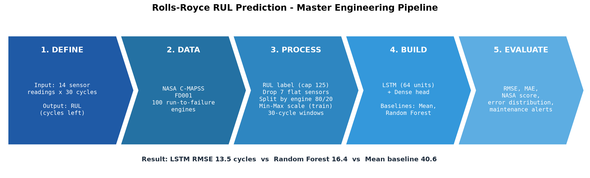

# Rolls-Royce: Remaining Useful Life (RUL) Prediction with LSTM

AI Mini Project 2 (Semester 2). Predicts how many operating cycles a turbofan engine has left before failure, using multi-sensor time-series data and an LSTM.

## Pipeline
1. **Define**: Input = 14 sensors x last 30 cycles; Output = RUL (cycles)
2. **Data**: NASA C-MAPSS, subset FD001 (100 run-to-failure engines, 21 sensors)
3. **Process**: RUL label capped at 125, drop 7 constant sensors, split by engine (80/20), Min-Max scaling fit on train only, 30-cycle windows
4. **Build**: LSTM (64 units) -> Dropout -> Dense(32) -> RUL; baselines: mean predictor and Random Forest
5. **Evaluate**: RMSE, MAE, NASA score, error distribution, maintenance alerts



## Results (100 test engines)
| Model | RMSE | MAE | NASA score |
|---|---|---|---|
| Mean RUL baseline | 40.58 | 35.07 | 18,670 |
| Random Forest baseline | 16.37 | 11.70 | 654 |
| **LSTM (ours)** | **13.52** | **10.18** | **313** |

Maintenance alert (predicted RUL <= 30 cycles): 23 of 25 due engines flagged, 2 false alarms.

## Run
```
pip install -r requirements.txt
python rul_lstm.py          # EDA, training, evaluation -> outputs/
python pipeline_diagram.py  # pipeline flow diagram -> outputs/pipeline_flow.png
```

## Files
- `rul_lstm.py`: full pipeline
- `pipeline_diagram.py`: draws the pipeline diagram
- `data/`: NASA C-MAPSS FD001 (train, test, true RUL, readme)
- `outputs/`: plots, `results.json`, `test_predictions.csv`, trained model `lstm_rul_model.pt`

Dataset: A. Saxena et al., "Damage Propagation Modeling for Aircraft Engine Run-to-Failure Simulation", PHM 2008, NASA Prognostics Center of Excellence.
